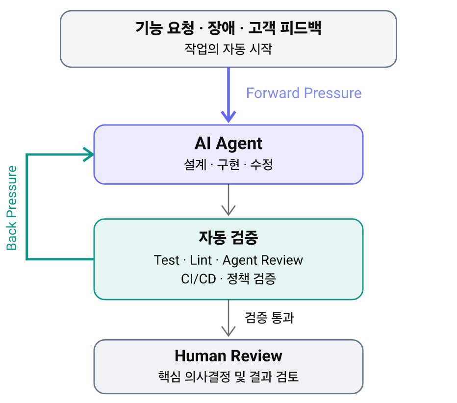

<https://youtu.be/-NFMsM2y0Vk?si=AHVnF50V5HaQzsCc>

컨텍스트 엔지니어링 개념을 소개했던 Dex Horthy 가 anti slop을 달성하기 위한 12가지 원칙을 공개했습니다. 발표내용 자체는 중요한 내용을 장표 텍스트만 읽고 넘어가거나 너무 옛 모델 데이터를 근거로 드는 등 전달력이 너무나 떨어졌지만, 원칙 자체는 의미가 있을 것 같아 가져와 봤습니다. 그러나 실은 이 원칙들 역시 우리 모두가 경험적 혹은 선험적으로 아는 것들이며 단지 체계화해두었다는 점 정도에서 의미를 갖지 않을까 합니다.

## Anti slop을 위한 12가지 원칙

① Forward Pressure 기능 요청이나 장애 발생이 자동으로 AI의 개발 작업을 시작하게 하라.

② Back Pressure 자동 검증과 피드백으로 AI가 스스로 결과물을 개선하게 하라.

③ Know Your Enemy AI의 장기적인 코드 유지보수 능력을 과신하지 마라.

④ Plan Before Build 구현에 앞서 문제, 설계, 요구사항을 정렬하라.

⑤ Visual Alignment 시각적 결과물을 활용해 사람과 AI의 의도를 일치시켜라.

⑥ Agentic Testing 에이전트가 직접 테스트할 수 있는 환경을 제공하라.

⑦ Lint Against Slop 반복되는 저품질 코드 패턴을 자동화된 규칙으로 차단하라.

⑧ Feature Flags 기능을 격리하고 실험할 수 있게 하라.

⑨ Eval Everything 에이전트의 성과를 평가하고 개선하라.

⑩ Compound Learning 과거 작업의 경험과 실패를 다음 작업에 반영하라.

⑪ Unify Your Forge 코드뿐 아니라 설계, 의사결정, 작업 맥락을 통합하라.

⑫ Build What You Can't Buy 조직 고유의 품질 기준과 검증 체계는 직접 구축하라.

## 결론

Dex가 말하는 핵심 원칙은 1, 2 번인데 당연한 내용을 포워드 프레셔나 백 프레셔라는 fancy 한 단어로 재포장 한 것에 불과하니 크게 겁먹을 필요는 없습니다.

개인적으로는 4, 5 번 원칙은 공감되지 않거나 원칙으로까지 둘 필요는 없다고 생각합니다.

9, 12원칙은 핵심은 맞으나 다들 how를 궁금해 하는데, 명쾌하게 설명되지 않았습니다. 조직 환경에 따라 천차만별이 될 수 밖에 없는 지점인 것은 맞으나 구체적인 예시가 있다면 더 좋았을 것 같네요.

##
